<div align="center">

# 🏛️ Mahājanaka

### The king who walked away. *A 1,500-year-old wall, retold one panel at a time.*

**The Mahājanaka Jātaka from the walls of Ajanta Cave 1, rebuilt as a graphic novel, a film storyboard and a playable animatic.**<br>
Hand-built in HTML, CSS and JavaScript, using real mural details, original illustrations drawn in code, and a tanpura drone synthesised live in the browser.


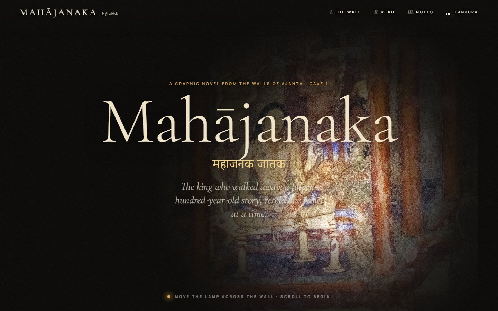

**Live site:** [https://mahajanaka-ajanta.vercel.app](https://mahajanaka-ajanta.vercel.app)<br>
[The idea](#idea) · [The story](#story) · [The comic](#comic) · [Director's cut](#director) · [Animatic](#animatic) · [Design choices](#design) · [How it's built](#built) · [Screenshots](#screenshots) · [Run it](#run) · [Credits](#credits)

</div>

---

## 📌 At a glance

| 📖 Panels | 📚 Chapters | 🖼️ Real mural details | ✏️ Original illustrations | 🎬 Animatic | 🎭 Characters | 📦 Build step |
|:---:|:---:|:---:|:---:|:---:|:---:|:---:|
| **18** | **5** | **7** | **11** | **3:01** | **4** | **None** |

---

<a id="idea"></a>
## 💡 The idea

Around 470 CE, monks and painters at Ajanta covered the left wall of the main hall of **Cave 1** with one long scene of the **Mahājanaka Jātaka**.
There are no frames and no words. The same king appears again and again as the story moves through palace rooms, courtyards and gateways.
Art historians call this ***continuous narration***.

The brief was to take a narrative from the Ajanta cave paintings and turn it into a modern visual story. So the project asks:

> What happens if a wall that was read by lamplight, one scene flowing into the next, is cut into frames, given words, and directed like a film?

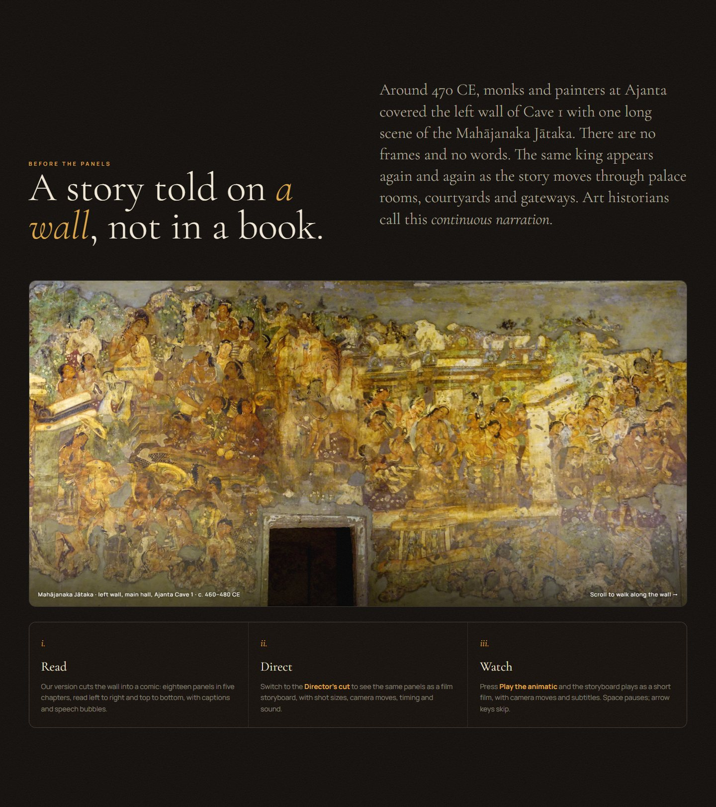

The site offers three ways into the same story:

| | Mode | What you get |
|:---:|---|---|
| 📖 | **Read** | A graphic novel: eighteen panels in five chapters, read left to right and top to bottom, with captions, speech and thought bubbles and sound effects |
| 🎬 | **Direct** | The *Director's cut*: the same panels as a film storyboard, with shot size, camera move, timing, sound and a director's note for every frame |
| ▶️ | **Watch** | *Play the animatic*: the storyboard played as a short film, with camera moves, subtitles and a live tanpura drone |

---

<a id="story"></a>
## 📜 The story

A Jātaka is a story of one of the Buddha's earlier lives. In this one (**Jātaka no. 539**) he is born a prince without a kingdom.

| | Character | Who they are |
|:---:|---|---|
| 🤴 | **Mahājanaka** | Prince of Videha, born in exile. In this life, the Bodhisattva |
| 👑 | **Sīvalī** | Princess of Mithila, later his queen. The one who tries hardest to hold him back |
| 🌊 | **Maṇimekhalā** | Goddess and guardian of the sea, sent to protect the virtuous |
| ⚔️ | **Polajanaka** | The king's younger brother, who seizes the throne of Mithila |

| Chapter | Where | What happens | Panels |
|:---:|---|---|:---:|
| **I · The Lost Prince** <br>मिथिला | Mithila, kingdom of Videha | Two royal brothers are turned against each other. Polajanaka kills the king and takes the crown. The pregnant queen escapes to Champā, where Mahājanaka is born. At sixteen he sails to win back his father's kingdom. | 3 drawn |
| **II · The Sea** <br>समुद्र | The ocean, bound for Suvaṇṇabhūmi | The ship breaks apart. He swims for seven days and seven nights. The goddess asks why he struggles with no shore in sight: *"One who keeps striving cannot be blamed."* | 4 drawn |
| **III · The Crown** <br>मुकुट | Mithila | A riderless festive chariot stops at the feet of the sleeping stranger. He strings the bow no one could bend, finds the sixteen hidden treasures, marries Sīvalī and is crowned. | 1 drawn · 2 mural |
| **IV · Two Mango Trees** <br>आम्र | The royal garden | The mango tree heavy with fruit is torn apart, while the barren one stands whole. *"A kingdom is fruit."* He takes his last royal bath. | 1 drawn · 2 mural |
| **V · The Walk Away** <br>निष्क्रमण | Mithila, and beyond | Sīvalī tries everything, even setting the city alight. *"When Mithila burns, nothing of mine burns."* He walks into the Himālaya and never returns. | 2 drawn · 3 mural |

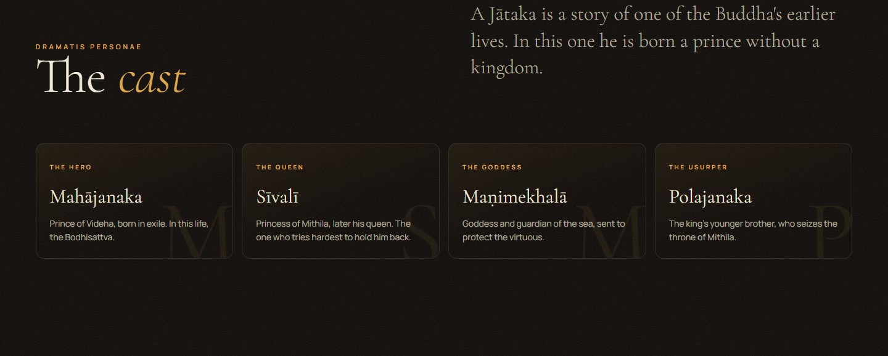

---

<a id="comic"></a>
## 📖 The graphic novel

Each chapter is a comic page on a 6-column grid. Every panel is one of two kinds:

| Kind | Count | What it is |
|---|:---:|---|
| 🖼️ **Mural** | 7 | A detail of the real Cave 1 painting, cropped from 2K+ photographs. It is labelled with its source, and clicking it opens the full mural detail with its photo credit. |
| ✏️ **Drawn** | 11 | A new illustration for an episode that no longer survives on the wall: the city, the flight, the shore, the storm, the swim, the goddess, the rescue, the chariot, the mango trees, the reed and the forest. Each one is **drawn in code as SVG** in the Ajanta palette of lamp black, red and yellow ochre, lapis and malachite. |

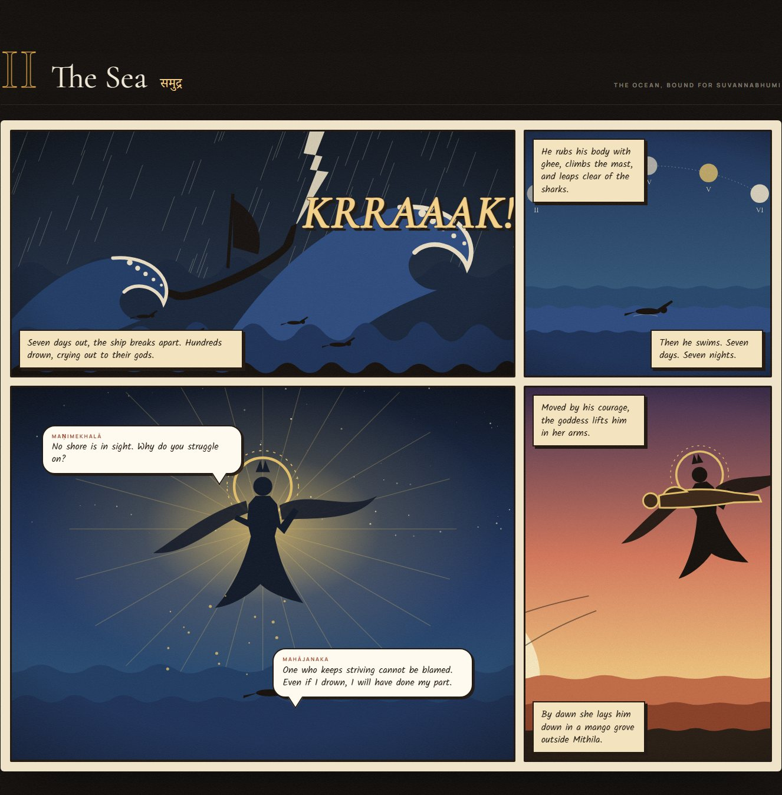

The panels use comic grammar on purpose. There are narration captions (23 in all), speech bubbles (9, one of them a dotted thought bubble), and one sound effect: **KRRAAAK!** as the ship splits.
The goddess panel is the biggest frame in Chapter II, because that is the heart of the story.

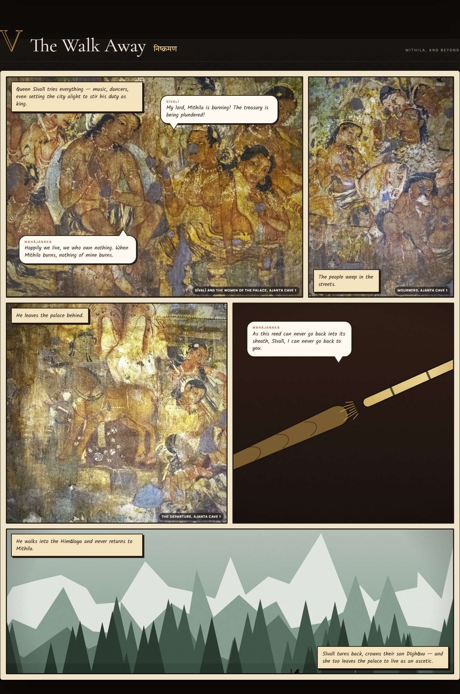

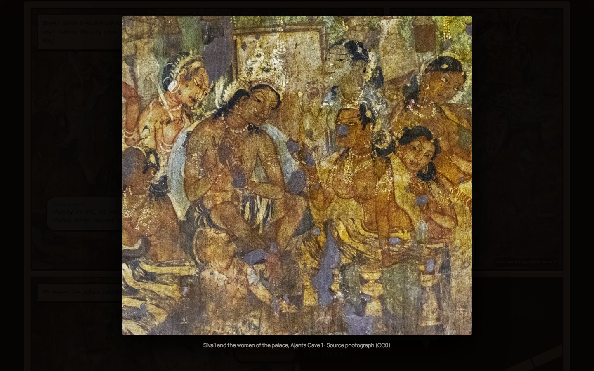

---

<a id="director"></a>
## 🎬 The Director's cut

One toggle turns the comic into a **film storyboard**. Every panel gets the notes a director would give, in this format:

| Shot | Size | Camera | Time | Sound | Director's note |
|:---:|---|---|:---:|---|---|
| **04** | Extreme long shot | Dutch angle, hand-held shake | 4s | Thunder, splintering wood | The only frame in the book with a tilted horizon: the world turns over. |
| **06** | Long shot, low angle | Crane up from the swimmer to the goddess | 8s | Choir swell over the waves | The heart of the story: effort (*vīriya*) is praised even when success is impossible. |
| **11** | Wide, symmetrical | Locked-off; the frame is split by a centre line | 6s | Birdsong, then silence | A split composition for the moment the king is split in two. |
| **13** | Medium close-up | Very slow push-in on his face | 6s | Single bell | The calmest face in the book: the decision is made inside, not out. |
| **17** | Extreme close-up | Static; the reed is pulled out in one motion | 4s | A dry rustle, then nothing | The smallest object in the book carries its biggest decision. |
| **18** | Extreme long shot | Slow crane up and away | 8s | Wind through deodars; end theme | Mirror of the first frame: a city of silhouettes becomes a forest of them. |

Each card also lists the shot's text and its source (a mural detail, or *reimagined from the Jātaka text*). All 18 shots add up to **1:36** of storyboard time.

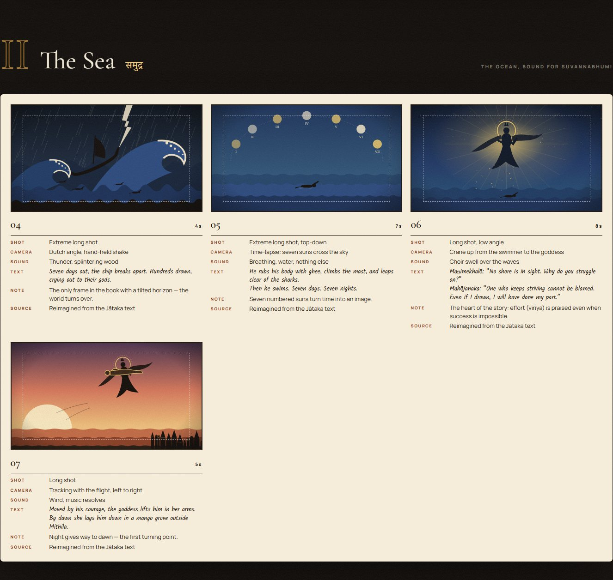

---

<a id="animatic"></a>
## ▶️ The animatic

**Play the animatic** opens a full-screen player that runs the storyboard as a short film, about **3 minutes** long.

- **Camera moves come from the storyboard notes.** "Dutch angle" tilts and drifts the frame, "push-in" zooms, "crane" rises, "tilt" moves up or down, "pan/track/drift" slides sideways and "time-lapse" creeps.
- **Each shot lasts long enough to read.** That is the storyboard time or the subtitle reading time (2.7 words a second plus 1.4 s), whichever is longer. That is why the film runs 3:01 against 1:36 of storyboard.
- **Subtitles** name the speaker, and a progress bar, chapter name and shot details sit on screen.
- **Controls:** <kbd>Space</kbd> pauses, <kbd>←</kbd> <kbd>→</kbd> skip shots, <kbd>Esc</kbd> closes.

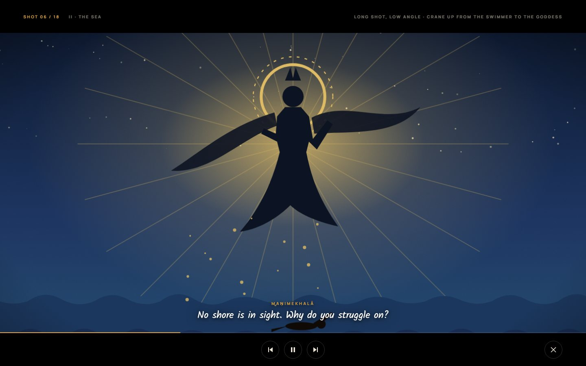

---

<a id="design"></a>
## 🧭 Design choices

Reimagining the mural meant deciding what each moment means. These four ideas shaped how every panel was framed:

| | Idea | How it shows up |
|:---:|---|---|
| **वीर्य** | **Vīriya: effort** | In the sea, effort is valued even with no reward in sight, so the goddess panel is the biggest frame in Chapter II, shot from a low angle so the swimmer looks heroic. |
| **नैष्क्रम्य** | **Renunciation** | The king leaves at the peak of his power, not in defeat. The bath panel is the calmest face in the book because the decision is made inside him. |
| **आम्र** | **What we own, owns us** | The fruit-laden mango tree is torn apart, while the barren one stands whole. It gets a split, symmetrical frame: the one moment where the story divides. |
| **शिवली** | **The one left behind** | Sīvalī's grief and anger are the story's counterweight. Ajanta paints the palace women with great tenderness, so her panels use only the real mural. |

**How Ajanta tells it, and how we tell it:**

| | Ajanta, Cave 1 | This project |
|---|---|---|
| **Format** | One continuous wall; many moments share one surface, and the hero appears again and again | Eighteen separate panels in five chapters, each holding one moment |
| **Time** | Moments arranged by place: rooms, courtyards and gateways. The viewer pieces the order together | Strict reading order, plus a timed animatic |
| **Words** | None on the wall; monks and guides told the story aloud | Narration captions, speech and thought bubbles, and sound effects |
| **Viewpoint** | Shifting, many-angled space; figures sized by importance, not distance | Film grammar: shot sizes, low angles, a Dutch tilt for the shipwreck, push-ins for decisions |
| **Medium** | Mineral pigments (ochres, lamp black, lime white, green earth, imported lapis lazuli) on dry lime plaster | Photographic details of the same mural, and new SVG illustrations in that palette |
| **Audience** | Monks and pilgrims walking a monastery hall (*vihāra*) by lamplight | A reader with a screen, lamplight and all: the cursor is the lamp on the title page |

---

<a id="built"></a>
## ⚙️ How it's built

No framework, no bundler and nothing to install. The whole site is static files, and the story itself is data.

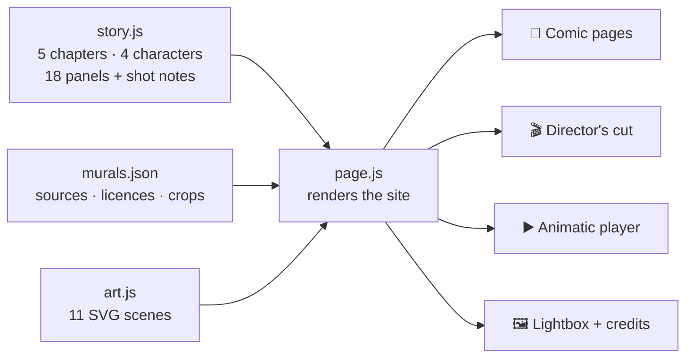

| File | What it does |
|---|---|
| [`index.html`](index.html) | Page structure: title page, the wall, cast, reader, notes, brief and credits |
| [`assets/data/story.js`](assets/data/story.js) | **The script.** Chapters, cast and all 18 panels, each with its kind, grid span, captions, bubbles, sound effects and storyboard notes |
| [`assets/data/murals.json`](assets/data/murals.json) | Source file, photographer, licence and crop size for every mural image |
| [`assets/js/page.js`](assets/js/page.js) | Lamp-lit title page, the horizontal walk along the wall, comic renderer, Director's cut toggle, animatic player, lightbox and credits |
| [`assets/js/art.js`](assets/js/art.js) | The 11 illustrated scenes, drawn as SVG in code |
| [`assets/js/tanpura.js`](assets/js/tanpura.js) | A tanpura drone **synthesised live with the Web Audio API**: four strings tuned Pa · Sa · Sa · Sa (low), plucked in a 4.8 s cycle, with a sweeping band-pass for the *jawari* buzz. No audio files. |
| [`assets/js/core.js`](assets/js/core.js) | Loader, Lenis smooth scroll, custom cursor, page transitions, scroll reveals, footer and sound toggle |
| `assets/css/` | `core.css` (shared system) and `story.css` (comic, storyboard, animatic, lightbox) |
| `assets/lib/` | GSAP, ScrollTrigger, SplitText, CustomEase, Flip, Observer and Lenis, vendored |
| `assets/fonts/` | Self-hosted Cormorant Garamond, Manrope, Kalam and Noto Serif (Devanagari, Bengali, Tamil, Telugu) |
| `assets/img/m/` | Mural crops, each in a full size and a 1200 px `-sm` version for `srcset` |
| [`tools/`](tools) | `devserver.py` (local server with caching off) and `bust.py` (adds a version query to CSS and JS before each deploy) |

**Small details:**

- `prefers-reduced-motion` turns the motion off.
- Mural panels can be reached with the keyboard: <kbd>Enter</kbd> or <kbd>Space</kbd> opens one, and <kbd>Esc</kbd> closes it.
- Animatic subtitles sit in an `aria-live` region.
- Adding `?shot` to the URL renders every section static and fully revealed. The screenshots here were taken that way.

---

<a id="screenshots"></a>
## 🖼️ Screenshots

| | |
|:---:|:---:|
| 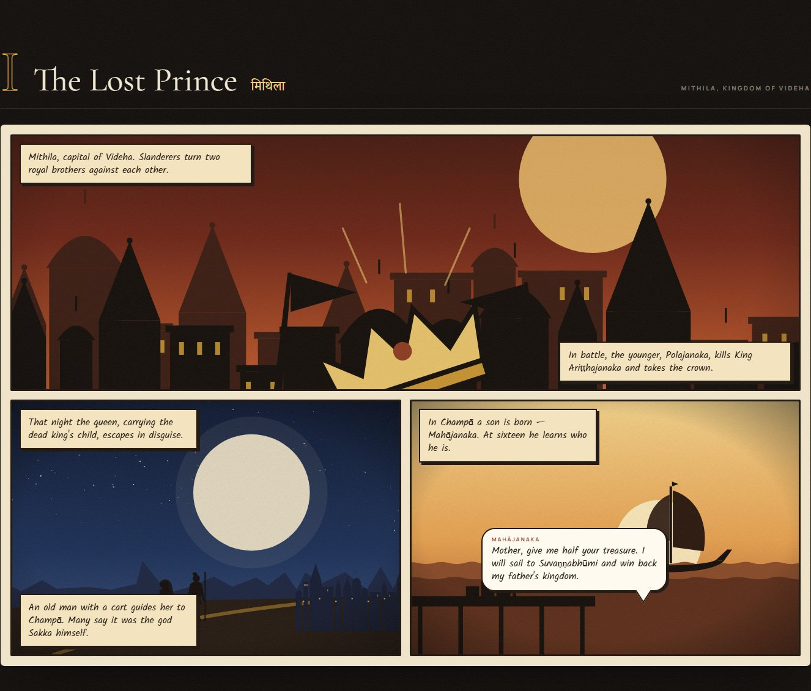<br>**I · The Lost Prince** (drawn in code) | 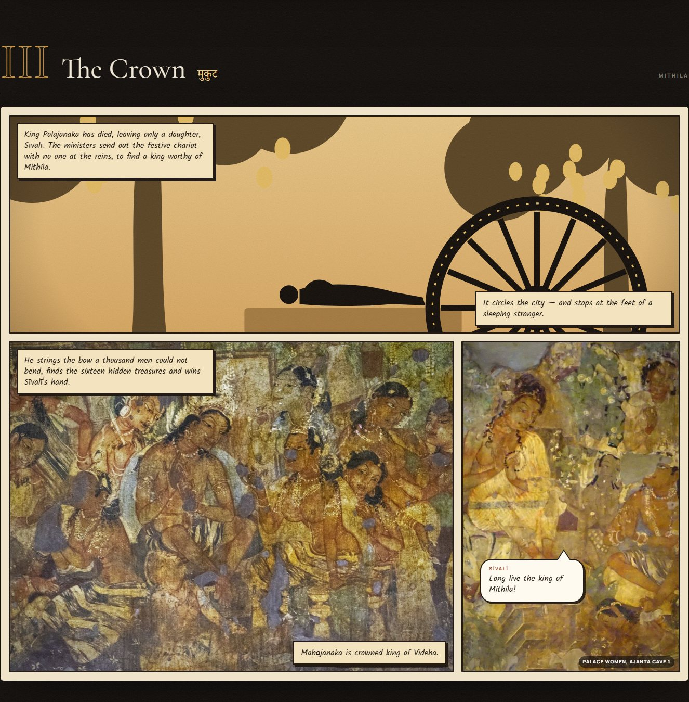<br>**III · The Crown** (the story reaches the real wall) |
| 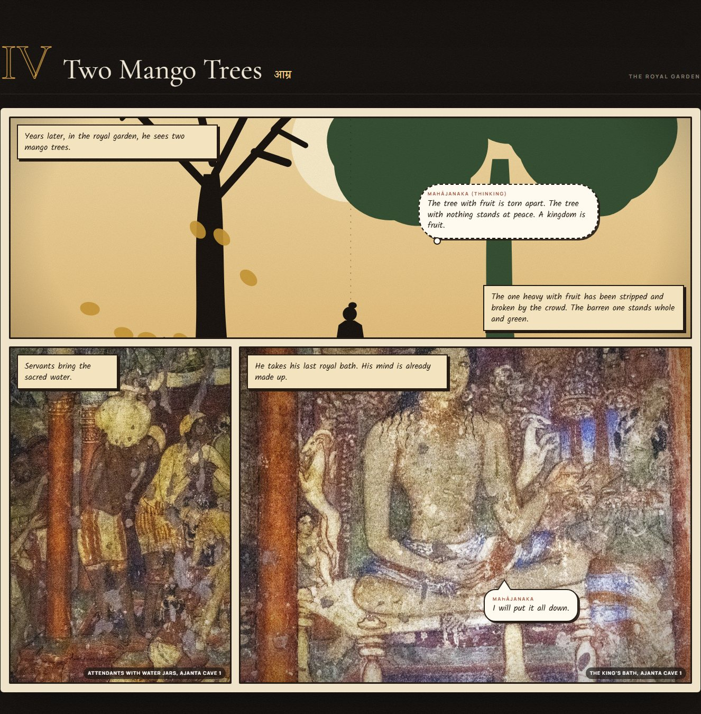<br>**IV · Two Mango Trees** (the thought bubble and the last bath) | 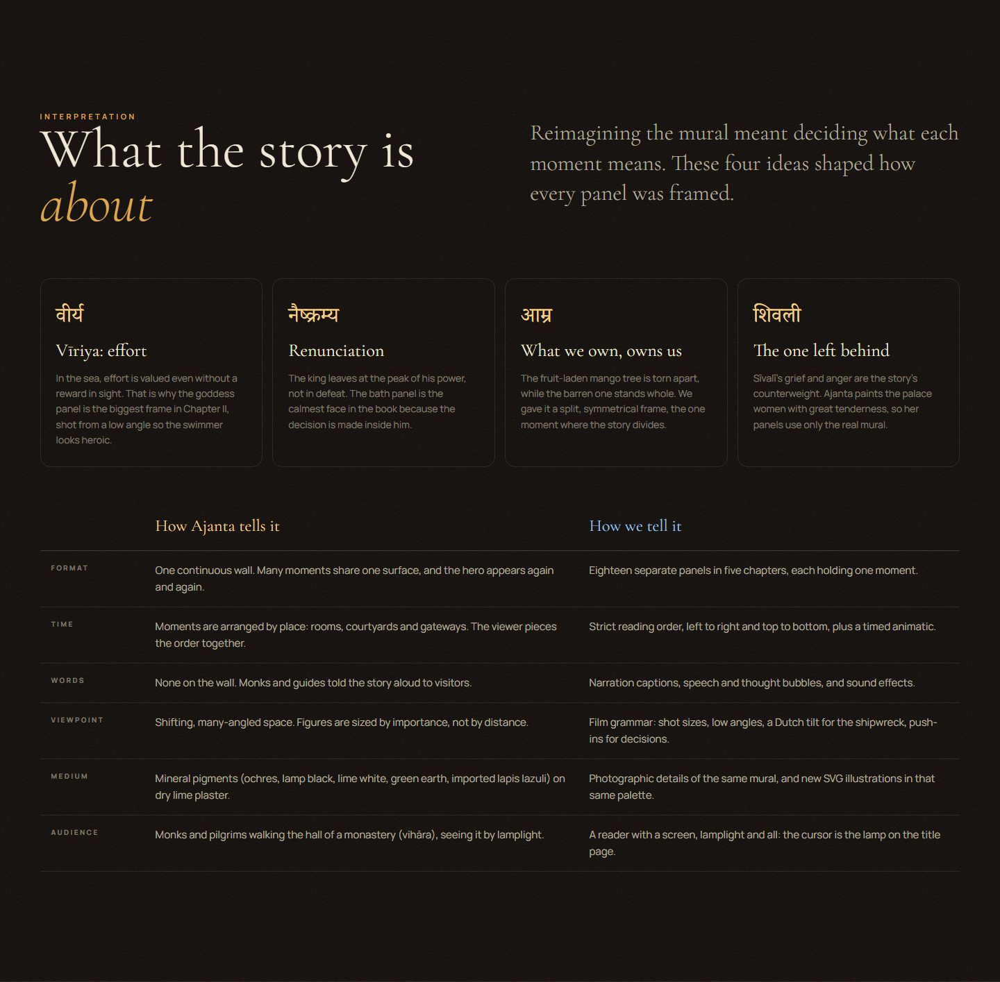<br>**What the story is about**, and Ajanta against us |
| 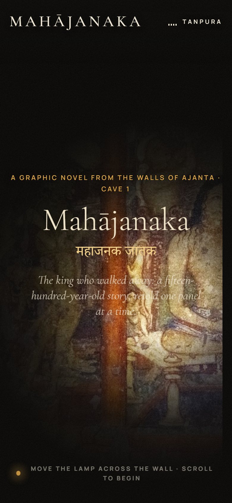<br>**On a phone** | <br>**Director's cut** |

---

<a id="run"></a>
## ▶️ Run it

```bash
git clone https://github.com/krishkavin7512/Mahajanaka-Ajanta.git
cd Mahajanaka-Ajanta
python tools/devserver.py 5173     # opens on http://127.0.0.1:5173
```

Any static file server works too, since there is nothing to build. To deploy:

```bash
python tools/bust.py               # version the CSS and JS links so browsers fetch the new files
vercel --prod                      # the folder is linked to the Vercel project "mahajanaka-ajanta"
```

```
index.html
assets/
  data/   story.js  murals.json
  js/     core.js  page.js  art.js  tanpura.js
  css/    core.css  story.css
  lib/    gsap  ScrollTrigger  SplitText  CustomEase  Flip  Observer  lenis
  img/m/  mural crops (full and -sm)
  fonts/  self-hosted woff2
tools/    devserver.py  bust.py
docs/     screenshots for this README
```

---

## 🎓 About the project

| | |
|---|---|
| **Course** | Indian Art Form · 21LEM110T |
| **Assessment** | CLA-II · Cave Paintings Storyboard · 10 marks · Course outcome CO2 |
| **Brief** | Create a storyboard or graphic novel that depicts a narrative from the Ajanta cave paintings, translating its scenes into a visual narrative format |
| **Objective** | To interpret and reimagine historical and religious narratives in a modern visual storytelling format |
| **Narrative** | The Mahājanaka Jātaka (no. 539), left wall of the main hall, Ajanta Cave 1, late 5th century CE, Vākāṭaka period |
| **Team** | Kavin Krish Vijay · Tanay Krishnan · Ryan Fernandes · Prithvi Chauhan |

---

<a id="credits"></a>
## 📄 Credits and sources

**Mural photographs.** Details are cropped from photographs on Wikimedia Commons:

| Used for | Source photograph | By | Licence |
|---|---|---|---|
| Title page, the king's bath, attendants with water jars | [Painting in Ajanta Cave 1-9](https://commons.wikimedia.org/wiki/File:Painting_in_Ajanta_Cave_1-9.jpg) | Biswas Dibyendu | [CC0](http://creativecommons.org/publicdomain/zero/1.0/deed.en) |
| The court of Mithila, Sīvalī and the palace women, mourners | [Painting in Ajanta Cave 1-15](https://commons.wikimedia.org/wiki/File:Painting_in_Ajanta_Cave_1-15.jpg) | Biswas Dibyendu | [CC0](http://creativecommons.org/publicdomain/zero/1.0/deed.en) |
| The departure | [Painting in Ajanta Cave 1-8](https://commons.wikimedia.org/wiki/File:Painting_in_Ajanta_Cave_1-8.jpg) | Biswas Dibyendu | [CC0](http://creativecommons.org/publicdomain/zero/1.0/deed.en) |
| The wall, palace women | [027 Cave 1, the Renunciation](https://commons.wikimedia.org/wiki/File:027_Cave_1,_the_Renunciation_(33896227560).jpg) | Photo Dharma, Sadao, Thailand | [CC BY 2.0](https://creativecommons.org/licenses/by/2.0) |

**Illustrations.** Shots 1–8, 11, 17 and 18 are original vector artwork drawn by the team in code.

**Text.** Retold from the Mahājanaka Jātaka (no. 539), after E. B. Cowell (ed.), *The Jātaka, or Stories of the Buddha's Former Births*, vol. VI (Cambridge, 1907). The dialogue is lightly adapted for speech bubbles.

**Type and motion.** Cormorant Garamond, Manrope, Kalam and Noto Serif are used under the SIL Open Font Licence. Motion uses [GSAP](https://gsap.com) and [Lenis](https://github.com/darkroom-engineering/lenis).
